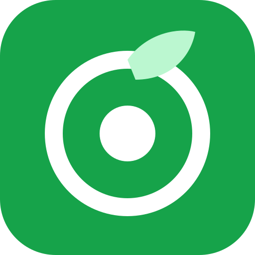

<div align="center">



# HealthyFood

**Open-source AI diet planner and food-photo nutrition tracker, running entirely on free open models.**

Set a goal, get an AI meal plan you can edit, snap a photo of your food to get calories and macros, and watch the rest of your day re-balance itself.

[](LICENSE)


[](https://render.com/deploy)

</div>

---

## Why HealthyFood?

Most diet apps are closed, paywalled and keep your health data on their servers. HealthyFood is:

- **Free to run.** It uses only `:free` models on [OpenRouter](https://openrouter.ai), with each user bringing their own free API key.
- **Private by design.** No accounts and no database: your profile, plans and logs stay in your browser's localStorage.
- **Honest with numbers.** AI supplies the food knowledge, but calorie targets and totals are computed in code, so they always add up.
- **Hackable.** Plain JavaScript, one repo, one `npm run dev`. MIT licensed.

## Features

| | Feature | How it works |
|---|---|---|
| 🎯 | **Goal-based targets** | Mifflin-St Jeor BMR × activity → TDEE, adjusted for lose / maintain / gain / build muscle at a chosen pace. Protein by body weight, keto-aware macros, fibre and water targets. |
| 🍽️ | **AI diet plan** | One day or a full week of meals for your diet type (veg, vegan, eggetarian, Jain, keto…), cuisine, budget, allergies and dislikes. Avoids repeating dishes across days. |
| ✏️ | **Fully editable plan** | Change quantities (macros rescale), **remove** items such as eggs or milk, **AI-swap** an item ("dairy-free", "higher protein"), add food by describing it, regenerate one meal, **"never suggest again"**, and **undo**. |
| 📸 | **Food photo analysis** | Camera or upload → image compressed in the browser → free vision model detects each food with portion, kcal, protein, carbs, fat, fibre, a confidence score and a health score. Everything is editable before saving. |
| 🔄 | **Adaptive day** | Log what you actually ate (or mark that it *replaced* a planned meal). **Adjust my day** re-balances the remaining meals to land on target, shows a before/after diff, and falls back to offline portion scaling if the AI is unavailable. Optional auto-adjust. |
| ✅ | **Daily tracker** | Calorie ring, macro bars, tick off planned meals, water tracker. |
| 📝 | **Natural-language logging** | "2 rotis, dal and a glass of buttermilk" → itemised nutrition. |
| 💬 | **AI coach** | Chat that knows your goal, today's intake and remaining meals. |
| 🛒 | **Grocery list** | Merged, shop-friendly list from 1, 3 or 7 days of plans, with checkboxes and copy-to-clipboard. |
| 👩‍🍳 | **Recipes** | One tap for ingredients and steps for any planned meal. |
| 📈 | **Progress** | Weight trend, 14-day calorie chart, logging streak, BMI. |
| ⚠️ | **Allergy guard** | Warns when a planned, scanned or swapped food matches your allergies (with synonyms, e.g. *milk → paneer, ghee, curd*). |
| 🔑 | **Bring your own key** | Paste and test your OpenRouter key in Settings. It is saved in localStorage only. |
| 🤖 | **Live free-model picker** | Lists the models that are free on OpenRouter right now (text and vision separately), with automatic fallback. |
| 💾 | **Export / import** | JSON backup of all your data (never includes the key). |
| 📱 | **PWA, dark mode, mobile-first** | Install it on your phone like an app. |
| 📴 | **Offline demo mode** | One click loads sample data and answers every AI feature locally, with no internet and no key. Your real data is backed up and restored on exit. |

## Architecture

```
┌──────────────────────── Browser (React + Vite) ────────────────────────┐
│  localStorage: API key · profile · plans · logs · water · weight · chat │
│  nutrition.js: BMR/TDEE/targets, totals, scaling, allergen check        │
└───────────────┬────────────────────────────────────────────────────────┘
                │  fetch /api/*   header: X-OpenRouter-Key
┌───────────────▼──────────── Express server (Render) ───────────────────┐
│  • serves client/dist (SPA)       • helmet, rate limit, 10 MB body cap  │
│  • builds prompts                 • zod-validates every AI response     │
│  • model fallback chain           • one self-repair retry on bad JSON   │
│  • key is forwarded, never stored or logged                             │
└───────────────┬────────────────────────────────────────────────────────┘
                │  POST /api/v1/chat/completions
        ┌───────▼────────┐
        │   OpenRouter   │  free text + vision models (":free")
        └────────────────┘
```

### Making free models reliable

Free models can be rate-limited, disappear, or return messy output. HealthyFood handles this in `server/lib/openrouter.js`:

1. **Fallback chain.** Your chosen model goes first, then the defaults in `server/lib/models.config.js` (ending with `openrouter/free`, OpenRouter's free router). A 429, a 5xx, an unavailable model or an empty answer moves on to the next model. A bad key (401) stops immediately with a clear message.
2. **Robust JSON extraction.** Code fences, `<think>` blocks, surrounding prose and trailing commas are stripped (`server/lib/json.js`).
3. **Schema validation and self-repair.** Output is validated with zod (numbers as strings are coerced, missing fields defaulted). If it is still invalid, the model is shown its error and asked once to fix it.
4. **Live model discovery.** `GET /api/models` reads OpenRouter's catalogue and keeps only zero-priced chat models, tagging the vision-capable ones.

## Tech stack

- **Frontend:** React 19, Vite, Tailwind CSS v4, React Router, Zustand (persisted to localStorage), Recharts, lucide-react
- **Backend:** Node.js, Express 5, zod, helmet, express-rate-limit
- **AI:** OpenRouter free models (e.g. Google Gemma 4, NVIDIA Nemotron VL, or the `openrouter/free` router)
- **Testing / CI:** Vitest, Supertest, GitHub Actions
- **Hosting:** Render (one web service)

## Quick start

**Requirements:** Node.js 20+ and a free OpenRouter key from **https://openrouter.ai/keys**.

```bash
git clone <your-repo-url> healthyfood
cd healthyfood
npm install
npm --prefix client install
npm run dev
```

- App: http://localhost:5173 (Vite, proxies `/api` to the server)
- API: http://localhost:3000

Open the app, go to **Settings → OpenRouter API key**, paste your key and press **Save**. The key is tested, then stored in your browser.

### Production build locally

```bash
npm run build   # builds client/dist
npm start       # Express serves the app + API on http://localhost:3000
```

### Tests

```bash
npm test
```

There are 34 tests covering the API routes (OpenRouter is mocked: success, invalid-JSON repair, 401, 429 fallback, vision payload), JSON extraction, the schemas, the nutrition maths, the day-state logic and the offline demo engine.

## Offline demo mode

For presentations on unreliable Wi-Fi, open **/demo** (also in the sidebar and on the welcome screen) and press **Start offline demo**.

- Loads a sample user (Asha: eggetarian, fat loss, peanut allergy) with today's plan and two weeks of logs, water and weight history.
- Every AI call is answered in the browser by `client/src/lib/demo.js`: canned meal plans scaled to the user's targets (allergens filtered out), rule-based swaps, an offline food database for text logging, sample photo analyses, portion-scaling day adjustment, keyword-based coach answers, and a local grocery list and recipe builder.
- **Scan → Try sample meal** uses a bundled plate illustration, so the photo flow works without a camera.
- The /demo page includes a 3-minute demo script that links to each feature.
- Exiting restores your real profile, plans and logs. The API key and settings are never touched.

To run fully offline, either start the app locally (`npm run build && npm start`, which needs no internet), or open the deployed site once while online so the service worker caches it.

## Deploy to Render

The repo includes a [`render.yaml`](render.yaml) blueprint.

1. Push this repo to GitHub.
2. In Render: **New → Blueprint**, then select the repo. Render reads `render.yaml`.
3. It runs `npm install && npm run build`, then `npm start`, with health check `/api/health`.
4. Open your `https://<name>.onrender.com` URL and add your key in Settings.

Manual setup instead: **New → Web Service**, Runtime *Node*, Build `npm install && npm run build`, Start `npm start`.

> On Render's free plan the service sleeps after inactivity, so the first request can take around 30–50 s.

### Environment variables (all optional)

| Variable | Default | Purpose |
|---|---|---|
| `PORT` | `3000` | Set automatically by Render |
| `OPENROUTER_API_KEY` | – | Shared demo key used **only** when a visitor hasn't added their own. Leave empty to require bring-your-own-key. |
| `RATE_LIMIT_PER_MIN` | `60` | API requests per IP per minute |
| `APP_URL` | – | Sent to OpenRouter as `HTTP-Referer` for app attribution |

## API reference

All AI endpoints are `POST`, take JSON, and read the key from the `X-OpenRouter-Key` header. An optional `model` field in the body overrides the default model.

| Endpoint | Body | Returns |
|---|---|---|
| `GET /api/health` | – | `{ ok }` |
| `GET /api/models` | – | `{ text[], vision[], defaults }` (free models only) |
| `POST /api/validate-key` | – | `{ ok, label, isFreeTier }` |
| `POST /api/plan/generate` | `{ profile, targets, avoidMeals? }` | `{ meals[], tips[], model }` |
| `POST /api/plan/swap` | `{ item, mealName?, instruction?, profile }` | `{ item, reason }` |
| `POST /api/plan/regenerate-meal` | `{ meal, instruction?, profile, targets? }` | `{ meal }` |
| `POST /api/analyze-image` | `{ image: dataURL, hint? }` | `{ isFood, dish, items[] (with confidence), healthScore, notes }` |
| `POST /api/parse-food` | `{ text }` | `{ items[] }` |
| `POST /api/adjust-day` | `{ profile, targets, consumed, remainingMeals[] }` | `{ meals[], explanation }` |
| `POST /api/coach` | `{ messages[], context? }` | `{ reply }` |
| `POST /api/grocery-list` | `{ meals[], days? }` | `{ categories[] }` |
| `POST /api/recipe` | `{ meal, profile? }` | `{ title, prepMinutes, ingredients[], steps[], tips[] }` |

A food item always has the shape `{ name, qty, unit, grams, kcal, protein, carbs, fat, fiber }`.

Errors look like `{ error, code }`, where `code` is one of `NO_KEY`, `BAD_KEY`, `NO_CREDITS`, `RATE_LIMIT`, `BAD_REQUEST`, `BAD_JSON`, `MODEL_ERROR` or `TIMEOUT`.

## Project structure

```
├── server/
│   ├── index.js              Express app (security, rate limit, static SPA)
│   ├── lib/
│   │   ├── openrouter.js     chat() + chatJSON(): fallback, repair, errors
│   │   ├── json.js           tolerant JSON extraction
│   │   ├── schemas.js        zod schemas for requests and AI responses
│   │   ├── prompts.js        all prompts in one place
│   │   ├── models.config.js  default free model chain
│   │   └── route.js          validate → resolve key → handle → errors
│   └── routes/               meta.js · plan.js · food.js
├── client/
│   ├── public/               icon, manifest, service worker
│   └── src/
│       ├── lib/              nutrition · day · api · demo · image · hooks · utils
│       ├── store/useApp.js   persisted Zustand store
│       ├── components/       Layout, Macros, FoodItems, FoodDialogs, ui
│       └── pages/            Onboarding, Dashboard, Plan, Scan, Log, Coach,
│                             Grocery, Progress, Settings, Demo
├── tests/                    vitest suites
├── render.yaml               Render blueprint
└── .github/                  CI + issue/PR templates
```

## Privacy and security

- The API key lives in your browser's localStorage and travels only over HTTPS to this server, which forwards it to OpenRouter. It is never written to disk or to logs.
- Food photos are resized in the browser and sent for analysis. Only a 128 px thumbnail is kept, locally.
- There are no accounts, no analytics and no database. Export your data any time; **Reset** clears it.
- Helmet CSP, a per-IP rate limit and request-body limits protect the server.

## Roadmap

- Barcode scanning with Open Food Facts
- Optional sync with a self-hosted backend
- Multi-language UI and regional food databases
- Wearable / step-count integration for dynamic TDEE
- Meal-prep mode (batch cooking for the week)

## Team

Built for the *Best Open Source AI Project* hackathon by a team of four:

| Member | Focus |
|---|---|
| _Name_ | Backend & AI: OpenRouter client, prompts, schemas, API tests |
| _Name_ | Diet plan & editing UI, nutrition maths, grocery & recipes |
| _Name_ | Food scan, logging, dashboard, adaptive day |
| _Name_ | Settings & key management, PWA, coach, progress, docs & deploy |

## Contributing

PRs are welcome. See [CONTRIBUTING.md](CONTRIBUTING.md) and our [Code of Conduct](CODE_OF_CONDUCT.md).

## Disclaimer

HealthyFood gives **AI-generated estimates for general wellness only**. It is not medical advice. Photo-based calorie estimates can be off by 20% or more. If you are pregnant, have diabetes, kidney disease, an eating disorder or any other medical condition, consult a qualified professional before changing your diet.

## License

[MIT](LICENSE) © HealthyFood contributors
